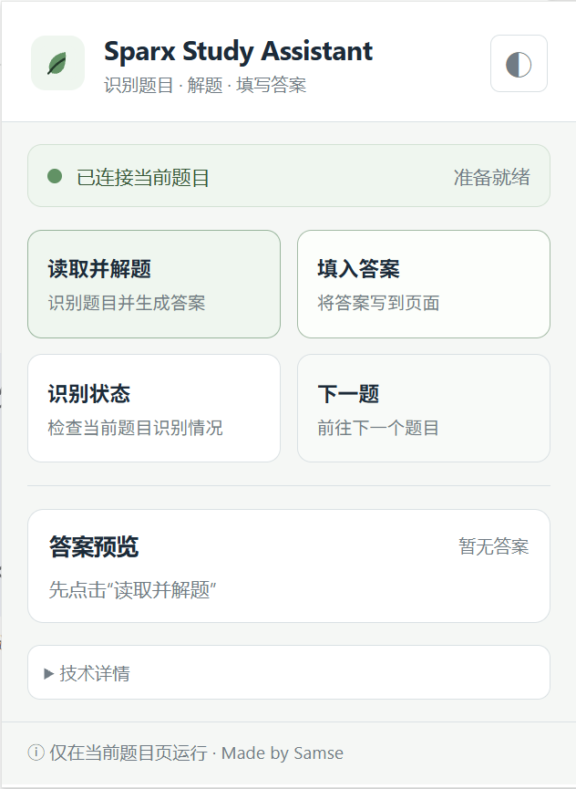

# Sparx Science Assistant

A local Chrome extension and Playwright bridge for reading Sparx Science questions, generating reviewable answers, and entering them into the current page.



## Features

- Reads text and image-based questions.
- Supports numeric fields, text fields, choices, and matching questions.
- Uses the Sparx on-page keypad for numeric answers.
- Uses clipboard paste for long text answers.
- Shows separated answer previews in the popup.
- Includes a functional light/dark theme switch.
- Selects the next question through Sparx navigation buttons (`nav-*`).

## Requirements

- Windows 10/11
- Google Chrome
- Node.js 20 or newer
- A configured upstream API key
- Chrome started with remote debugging on port 9222

## Installation

1. Download the release ZIP and extract it.
2. Open `chrome://extensions`.
3. Enable Developer mode.
4. Choose **Load unpacked** and select the extracted folder.
5. Open PowerShell in the extracted folder and run `npm install`.
6. Copy `.env.example` to `.env`, then set the API key.
7. Run `start-all.ps1`, or use the included batch launcher.
8. Open a Sparx Science question and click the extension icon.

## Configuration

Set these environment variables in `.env`:

```text
OPENAI_API_KEY=your-key
OPENAI_BASE_URL=https://api.openai.com/v1
OPENAI_MODEL=gpt-6.1-sol
```

The local solve service listens on `http://localhost:8787`. The Playwright automation service uses port `8788` and connects to Chrome on `127.0.0.1:9222`.

## Playwright setup

The project uses Playwright over the Chrome DevTools Protocol to connect to an existing Chrome instance. No separate Playwright browser download is required.

Install dependencies once:

```powershell
npm install
```

Start Chrome with remote debugging:

```powershell
$chrome="$env:ProgramFiles\Google\Chrome\Application\chrome.exe"
Start-Process $chrome -ArgumentList '--remote-debugging-port=9222','--user-data-dir=$env:USERPROFILE\SparxScienceAssistantProfile'
```

Check the debugging endpoint:

```powershell
Invoke-WebRequest http://127.0.0.1:9222/json/version
```

Start the services:

```powershell
node server.js
node automation-server.mjs
```

Alternatively, double-click `启动Sparx自动答题.bat`. It starts Chrome, the solve API, and the Playwright automation service.

## Usage

1. Click **读取并解题**.
2. Review the separated answers in **答案预览**.
3. Click **填入答案**.
4. Use **下一题** to select the next Sparx question tab.
5. Expand **技术详情** only when debugging is needed.

## Release

The distributable extension is in `release/SparxScienceAssistant-2.0.0.zip`. Do not include `.env`, API keys, browser profiles, or debug logs in a public release.

## License

GNU GPLv3. See `LICENSE`.

## Credits

Made by Samse.


